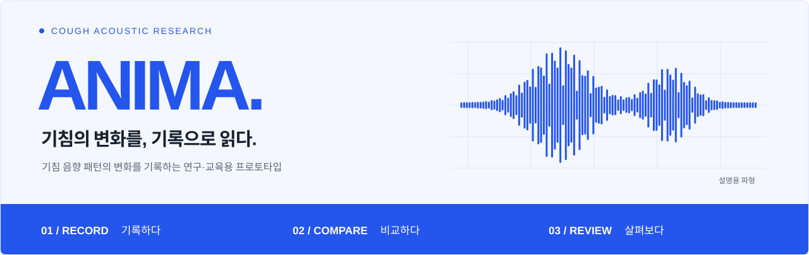
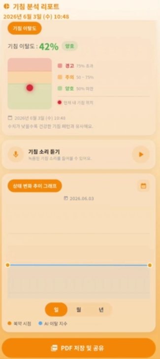
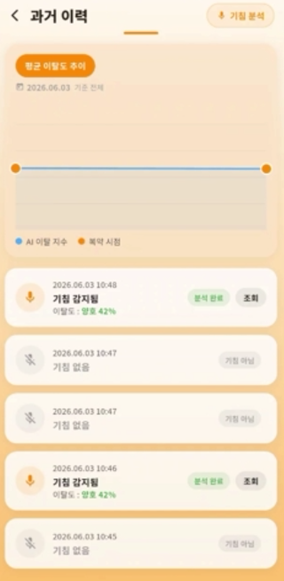
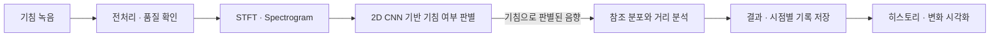

<p>
  <a href="https://shincssyou.github.io/anima/">프로젝트 웹사이트 ↗</a>
  &nbsp; / &nbsp;
  <a href="https://github.com/ShinCssyou/anima">GitHub 저장소 ↗</a>
  &nbsp; / &nbsp;
  <a href="#analysis">분석 흐름 ↓</a>
</p>



# 기침의 변화를, 기록으로 읽다.

**ANIMA**는 기침 소리를 분석하고, 기록을 쌓아 시간에 따른 음향 패턴의 변화를 살펴보는 **연구·교육용 프로토타입**입니다. 기침 여부와 녹음 품질을 확인하고, COUGHVID 기반 연구용 참조 분포와의 차이를 기록하는 시스템을 설계합니다.

한 번의 분석값보다 **여러 시점의 기록을 함께 읽는 경험**에 초점을 맞춥니다.

> **이 저장소에는 프로젝트 소개 문서와 정적 웹페이지가 담겨 있습니다.** Flutter 모바일 앱이나 FastAPI 분석 서버의 실행 소스를 배포하는 저장소는 아닙니다. 아래 내용은 프로젝트의 분석 설계와 기존 문서에 기록된 개발 내용을 소개합니다.

**연구용 지표 안내** · 분석값은 기침 소리의 음향적 특성과 차이를 나타냅니다. 특정 질환의 진단, 질병 확률 또는 중증도를 의미하지 않습니다.

---

## 프로토타입에서 확인할 수 있는 화면

중간발표에는 녹음·음성 업로드, CNN 기침 판별, 거리 기반 변화 분석, 결과 저장과 리포트 화면이 소개되어 있습니다. **웹 데모 구축과 앱 알파 테스트는 2026년 6월 23일 수행일지**, **MCU 보드 테스트는 8월 26일 수행일지**에 기록되어 있습니다.

<p align="center">
  
  &nbsp;
  
  &nbsp;
  
</p>

화면의 수치와 단계 표시는 시연 예시입니다. 임상적 건강 상태나 질병 위험도를 판정하는 기준으로 사용하지 않습니다.

[PDF 보고서 예시 보기](assets/pdf-report-example.jpg) — 발표자료의 **더미 데이터 20건**으로 만든 화면 이미지입니다. 실제 환자의 분석 결과나 다운로드용 PDF 파일이 아닙니다.

## ANIMA가 다루는 질문

**“같은 사람의 기침 소리는 시간에 따라 어떻게 달라질까?”**

ANIMA는 기침을 녹음하고 분석하는 단계에서 출발해, 날짜별 기록을 누적하고 변화를 확인하는 흐름을 목표로 합니다. 복약 여부나 주관적으로 느끼는 기침 빈도처럼 녹음 당시의 맥락도 함께 기록하는 구조를 고려합니다.

| 기록하기 | 비교하기 | 다시 살펴보기 |
| :--- | :--- | :--- |
| 기침 소리와 측정 시점의 정보를 남깁니다. | 음향 특징을 연구용 참조 분포와 비교합니다. | 날짜별 기록과 그래프에서 시간에 따른 변화를 살펴봅니다. |

<a id="analysis"></a>

## 소리에서 기록까지

아래는 프로젝트가 설계한 분석 흐름입니다.



1. **녹음 정리** — 16 kHz Mono를 기준으로 입력 음성을 정리하고, 잡음과 클리핑 등 녹음 품질을 확인합니다.
2. **소리의 특징 표현** — STFT와 스펙트로그램으로 시간에 따라 달라지는 주파수 성분을 표현합니다.
3. **기침 여부 판별** — 2D CNN을 이용해 입력 음성이 기침인지 분석합니다.
4. **참조 분포와 비교** — 기침으로 판별된 음향의 특징을 COUGHVID 기반 연구용 참조 분포와 비교하고, 마할라노비스 거리를 계산합니다.
5. **기록 누적** — 분석 결과를 날짜별로 저장하고, 여러 시점의 결과를 함께 살펴보는 구조로 연결합니다.

## 분석값을 읽는 방법

| 지표 | 나타내는 것 | 해석할 때 구분할 점 |
| :--- | :--- | :--- |
| **Cough Confidence** | 모델이 입력 음성을 기침으로 판단한 신뢰도 | 질병이 있을 확률을 뜻하지 않습니다. |
| **Quality Score** | 녹음 길이·잡음·클리핑 등을 반영하도록 정의한 입력 품질 지표 | 건강 상태를 평가하는 점수가 아닙니다. |
| **Mahalanobis Distance** | 참조 분포의 평균과 공분산을 고려한 통계적 거리 | 음향 특징이 기준에서 얼마나 떨어져 있는지 나타냅니다. |
| **Deviation** | 참조 분포와 현재 기침 음향 특징 사이의 차이를 표현하는 지표 | 질병 위험도나 중증도로 해석하지 않습니다. |

**거리가 크다고 질환이 있다고 판단할 수 없고, 거리가 작다고 건강하다고 보장할 수도 없습니다.** 시간에 따른 거리 변화 역시 건강 상태의 변화와 같은 뜻으로 해석하지 않습니다.

### 참조 데이터

초기 연구 데이터는 공개 기침 음향 데이터셋 **[COUGHVID](https://www.nature.com/articles/s41597-021-00937-4)**를 바탕으로 합니다. 기존 프로젝트 문서에서는 `healthy_cough`로 분류된 표본을 연구용 참조 분포 구성에 활용하는 방향을 설명합니다.

이 참조 분포는 음향 특징을 비교하기 위한 연구 기준입니다. 모든 사람에게 적용되는 임상적 정상 범위라는 뜻은 아닙니다. 향후에는 국내 사용자 데이터를 축적하고, 기침 음향 특성을 반영할 수 있도록 데이터셋과 모델을 확장하는 것을 목표로 합니다.

<details>
<summary><strong>함께 기록하도록 설계한 데이터 보기</strong></summary>

분석 결과뿐 아니라 측정 시점의 맥락과 분석 조건을 함께 남기는 구조를 목표로 합니다.

| 구분 | 항목 |
| :--- | :--- |
| 측정 정보 | 녹음 날짜·시간, 기침 감지 여부 |
| 분석 결과 | 기침 판별 신뢰도, Quality Score, Mahalanobis Distance, Deviation |
| 사용자 기록 | 복약 여부, 주관적 기침 빈도, 통증 정도 |
| 환경 정보 | PM10·PM2.5 등 측정 당시 환경 정보 |
| 분석 조건 | 사용한 참조 분포와 모델의 버전 |

</details>

---

## 시스템 구성과 기술

**모바일 앱 → 분석 서버 → 데이터베이스·오디오 저장소 → 기록 조회**로 이어지는 구조를 설계합니다. 웨어러블과 BLE 연동은 일상에서 기침 이벤트를 기록하기 위한 확장 방향입니다.

아래 기술은 **기존 프로젝트 문서에 기재된 구성**입니다.

| 영역 | 기술·구성 | 역할 |
| :--- | :--- | :--- |
| 모바일 | Flutter | 녹음, 분석 요청, 기록 조회를 위한 앱 |
| 분석 서버 | Python · FastAPI | 오디오 전처리, 품질 확인, 분석 요청 처리 |
| 음향·AI | STFT · Spectrogram · 2D CNN | 음향 특징 표현과 기침 여부 판별 |
| 통계 분석 | Mahalanobis Distance | 연구용 참조 분포와의 거리 계산 |
| 데이터 | Relational Database · Audio File Storage | 기록 데이터와 오디오 파일 저장 |
| 하드웨어 | Seeed Studio XIAO nRF52840 Sense · BLE | 웨어러블 구현 및 통신 연구 |
| 프로젝트 웹 | HTML · CSS · JavaScript | 프로젝트 소개와 문서 안내 |

## 개발 기록과 다음 단계

아래 내용은 **중간발표와 2026년 8월 26일까지의 수행일지 기준**입니다.

| 구분 | 자료에서 확인한 내용 |
| :--- | :--- |
| 구현·시연 | 녹음·음성 업로드, CNN 기침 판별, Mahalanobis Distance 분석, Deviation Score, 결과 DB 저장, 분석 리포트·과거 이력·PDF 보고서 |
| 테스트·개발 | 실기기 녹음 테스트, 웹 데모 구축, 앱 알파 테스트, 모델·참조 분포 도구 교체, 음성 저장 서버 분리, MCU 보드 테스트 |
| 향후 계획 | 개인별 참조 분포 연구, 베타 테스트, 국내 기침 데이터 수집, 웨어러블 연동, 산업용 음향 분석·대시보드 확장 |

| 날짜 | 주요 개발 기록 |
| :--- | :--- |
| 2026.04.07 | API 구현 완료, 프런트엔드·DB 설계, 기침 데이터 분류 도구 개발 |
| 2026.06.02 | AI 모델과 기준 분포 도구 교체, 별도 음성 저장 서버 구성, 해당 기침 데이터 라벨링 완료 |
| 2026.06.23 | 웹사이트 데모 구축, 앱 알파 테스트 후 개선사항 작성 |
| 2026.08.26 | 웹·서버·소개 페이지 작업, MCU 보드 테스트, 대시보드와 산업 음향 확장 계획 |

### 개발 과정에서 개선한 점

- **분석 목적 정리:** 질병 분류 중심의 초기 방향을 기침 음향의 변화 추적으로 바꾸고 파이프라인과 데이터셋을 재구성했습니다.
- **실기기 테스트:** 에뮬레이터의 녹음 패키지 문제를 확인한 뒤 실제 휴대폰에서 녹음과 기능을 테스트했습니다.
- **서버 환경 개선:** 무료 서버의 슬립 이후 요청 지연과 메모리 부족을 해결하기 위해 상시 실행되는 클라우드 환경으로 이전했습니다.

사용자 데이터로 개인별 참조 분포를 만드는 기능은 **향후 계획**입니다. 현재 공개 데이터 기반의 연구용 참조 분포와 구분합니다.

8월 수행일지에는 산업현장 기계음 데이터 확보, 산업용 음향 AI 학습, 대시보드·분석 서버 테스트와 하드웨어 제작 계획도 담겨 있습니다. 기침 분석과 병행하는 확장 연구이며, 완료된 산업용 제품으로 소개하지 않습니다.

## Team ANIMA

| 이름 | 담당 |
| :--- | :--- |
| **주세희 · 팀장** | 총괄 기획·문서화, 데이터 전처리·AI 모델, 학술 문서 작성, 하드웨어. IRB 승인 신청서 검토는 계획 |
| **이강민** | 서버 구축·보완, 데이터 라벨링, 앱·웹 서버 |
| **정해서** | UX·UI, 데이터베이스·프런트엔드, PDF·재생 기능, 웹 데모. 대시보드 백엔드는 계획 |
| **신호철** | 데이터 라벨링·노이즈 수집, 프로젝트 소개 페이지. 파일·소스 관리는 계획 |
| **임태희** | 웹·앱 로고 디자인, 앱 알파 테스트·사용성 피드백. 대시보드 디자인은 계획 |

---

## 이 소개 페이지 사용하기

`index.html`과 `assets` 폴더를 함께 내려받고, `index.html`을 브라우저로 열면 소개 홈페이지를 볼 수 있습니다. 별도의 설치나 빌드가 필요하지 않습니다.

```text
anima/
├── README.md
├── index.html
└── assets/
    ├── readme-banner.svg
    ├── app-recording.png
    ├── app-report.png
    ├── app-history.png
    └── pdf-report-example.jpg
```

README 배너와 구현 화면이 표시되도록 **`assets` 폴더 전체**를 함께 올려 주세요. 모바일·서버의 실행 환경은 이 소개 저장소에 포함되어 있지 않습니다.

---

**ANIMA · Record. Compare. Review.**

[프로젝트 웹사이트](https://shincssyou.github.io/anima/)에서 소개를 살펴보거나, [GitHub 저장소](https://github.com/ShinCssyou/anima)에서 문서와 정적 웹페이지 소스를 확인할 수 있습니다.
