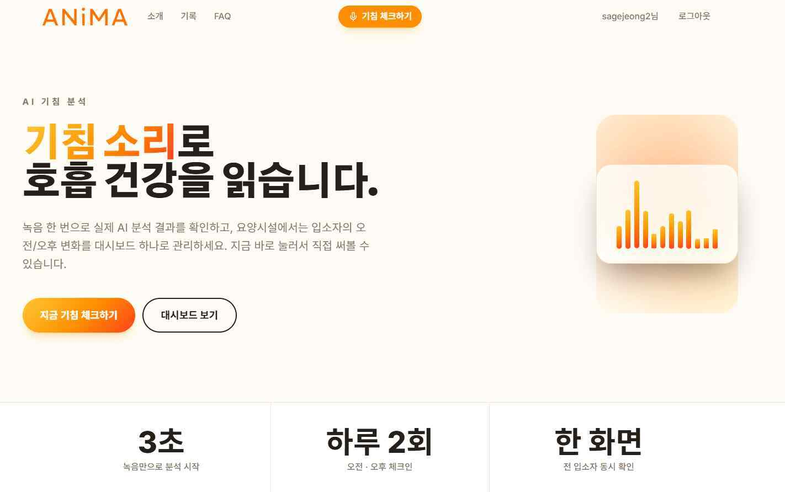
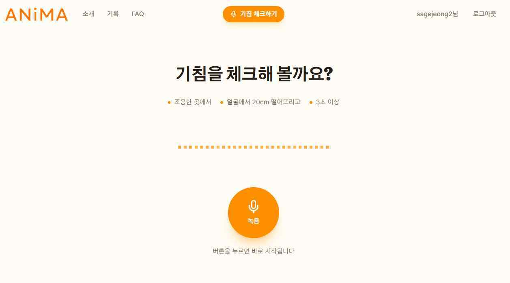
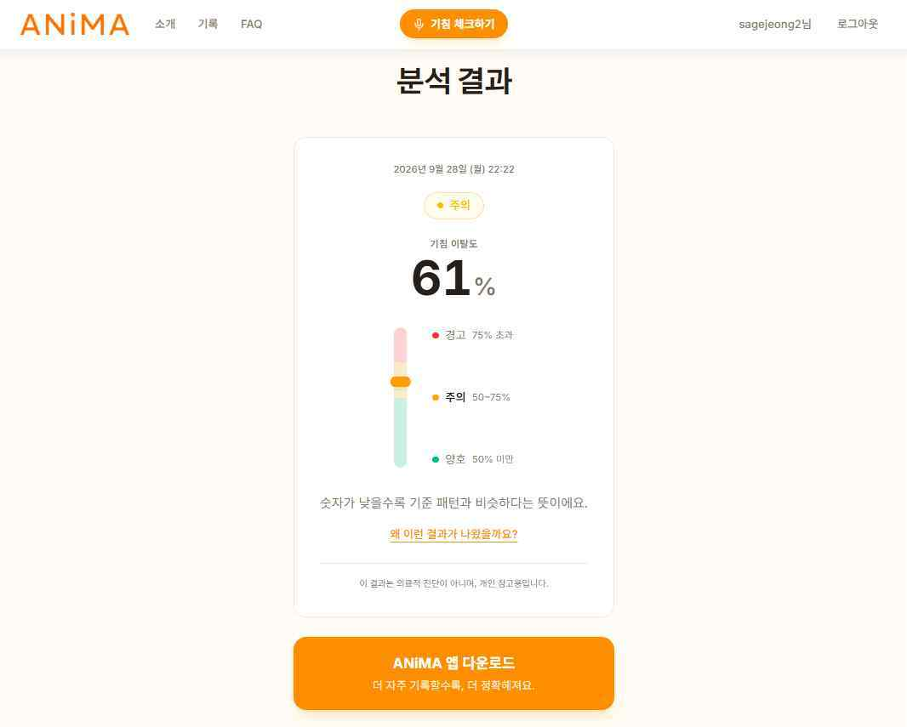
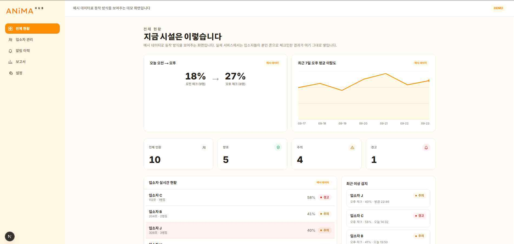
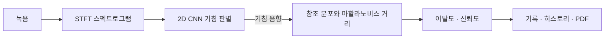

  <a href="https://shincssyou.github.io/anima/">프로젝트 소개 ↗</a>
  &nbsp; / &nbsp;
  <a href="https://animawith.cloud">웹 분석 ↗</a>
  &nbsp; / &nbsp;
  <a href="https://github.com/ShinCssyou/anima">GitHub 저장소 ↗</a>

# 기침의 변화를, 기록으로 읽다.

**ANiMA**는 기침 소리를 기록하고 음향 특징의 차이를 비교하는 연구·교육용 프로젝트입니다. 기침 여부를 판별한 뒤 참조 분포와의 거리를 계산하고, 결과를 날짜별 기록과 보고서로 연결합니다.

**2학기에는 앱과 웹의 완성도에 집중합니다.** 하드웨어 개발은 중단했으며, 동작하는 앱·웹 분석과 데모 대시보드를 구분해 소개합니다. 개인별 기준 분포는 앞으로 구현할 목표입니다.

> 이 저장소에는 README와 프로젝트 소개 홈페이지가 담겨 있습니다. 앱·분석 서버의 실행 소스는 포함하지 않습니다. 분석값은 음향적 차이를 나타내며 질병 진단이나 중증도 판정 결과가 아닙니다.

## 현재 어디까지 만들었나요?

| 구성 | 2학기 발표자료에 제시된 상태 |
| :--- | :--- |
| **모바일 앱** | 동작 · Flutter와 로컬 DB 기반, 실사용 테스트 중. 녹음, 결과, 그날의 상황, 히스토리·PDF 리포트 |
| **웹 분석** | 동작 · 앱 설치 없이 브라우저에서 녹음·분석 |
| **기관용 대시보드** | **데모 데이터**로 여러 사람의 상태를 한 화면에 표시. 실데이터 연동은 검토 계획 |
| **소개 홈페이지** | 공개 · 구현 화면, 분석 과정, 개발 기록과 팀 소개 |

[웹 분석 주소](https://animawith.cloud)는 발표자료에 안내된 서비스 주소입니다. 현재 접속 가능 여부나 상시 운영을 보장하는 표시는 아닙니다.

## 브라우저에서 이어지는 분석

  
  
  

*2학기 발표자료의 화면 · 웹 분석 시작 → 녹음 → 결과 확인*

  

*2학기 발표자료의 화면 · 기관용 대시보드는 데모 데이터입니다.*

## 두 단계로 소리를 읽습니다

- **1단계 — 기침 판별:** 소리를 스펙트로그램으로 바꾸고 2D CNN으로 기침·비기침을 구분합니다.
- **2단계 — 변화 비교:** 기침의 특징을 COUGHVID 기반 연구용 참조 분포와 비교해 거리와 이탈도를 계산합니다. 개인별 기준 분포는 향후 계획입니다.
- **결과 표시:** 이탈도를 0–100%로 표현하며, 신뢰도는 `기침일 확률 × 0.7 + 녹음 품질 × 0.3`으로 구성합니다. 이탈도와 신뢰도는 서로 다른 지표입니다.

화면의 ‘양호·주의·경고’는 프로젝트의 음향 지표 표시입니다. 질병 위험이나 임상적 정상 범위를 뜻하지 않습니다.

## 발표자료에 보고된 모델 성능

| 정확도 | F1 스코어 | AUC |
| :---: | :---: | :---: |
| **95.3%** | **96.1%** | **0.983** |

COUGHVID 기침 약 **17,000개**와 팀원이 녹음한 비기침 약 **11,000개**를 활용한 **자체 기침·비기침 분류 실험** 결과입니다. 질병 예측 성능이 아니며, 발표자료에는 데이터 분할 방식이나 외부 검증 절차가 제시되지 않았습니다.

## 앱과 웹을 연결하는 구성

| 영역 | 현재 자료에 제시된 구성 |
| :--- | :--- |
| 앱 | Flutter · 로컬 DB |
| 음향 분석 | STFT · 2D CNN · Mahalanobis Distance |
| 서버 | 태블릿 · Termux · Ubuntu 24.04 · FastAPI · Uvicorn · Docker |
| 외부 접속 | Cloudflare Tunnel · `animawith.cloud` |
| 소개 페이지 | HTML · CSS · JavaScript · GitHub Pages |

Render의 메모리·슬립 문제와 Oracle Cloud의 자원 한계를 거쳐 태블릿 서버로 이전했습니다. 소개 홈페이지는 설명용 정적 페이지이며, 음성을 수집하거나 분석 서버에 연결하지 않습니다.

## 다음 단계

- 한국인 기침 데이터 수집과 개인맞춤 기준 분포
- 대시보드의 실데이터 연동 검토
- 사용성 개선 후 앱 출시

## Team ANiMA

| 이름 | 담당 |
| :--- | :--- |
| **주세희 · 팀장** | AI 모델 개발 · 데이터 전처리 · 기획 |
| **정해서** | 앱 · 웹 프런트엔드 · DB 설계 |
| **이강민** | 서버 · 인프라 |
| **임태희** | 웹 디자인 · 앱 사용성 테스트 |
| **신호철** | 데이터 라벨링 · 소개 페이지 · 문서 관리 |

## 소개 페이지 사용하기

`index.html`과 `assets` 폴더를 함께 내려받고 브라우저에서 `index.html`을 열면 됩니다. 별도 설치나 빌드는 필요하지 않습니다. GitHub Pages에 올릴 때도 이미지가 담긴 `assets` 폴더를 함께 올려 주세요.

---

자료: **「1조 ANiMA_2학기 발표」(2026년 2학기 발표자료)** · 소개 문서 갱신: **2026.10.11**

[프로젝트 소개](https://shincssyou.github.io/anima/) · [GitHub 저장소](https://github.com/ShinCssyou/anima)