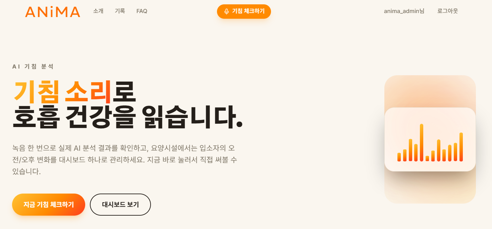
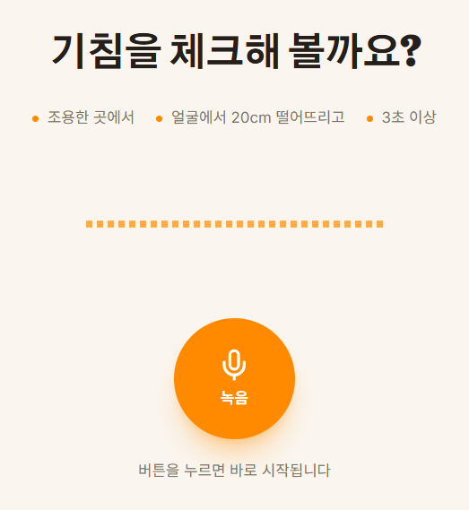
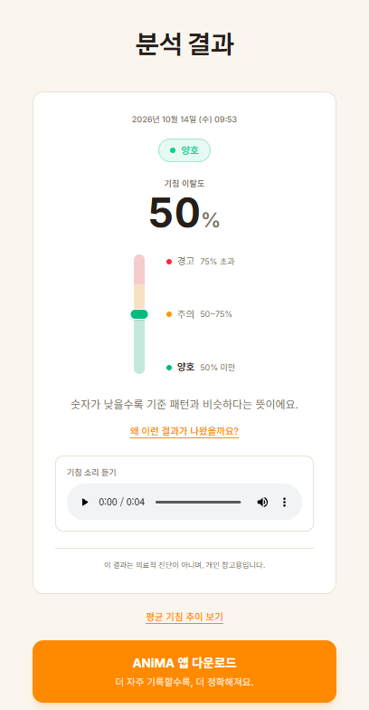
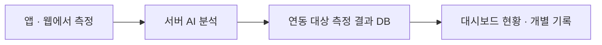

  <a href="https://shincssyou.github.io/anima/">프로젝트 소개 ↗</a>
  &nbsp; / &nbsp;
  <a href="https://animawith.cloud">웹 분석 ↗</a>
  &nbsp; / &nbsp;
  <a href="https://github.com/ShinCssyou/anima">GitHub 저장소 ↗</a>

# 기침의 변화를, 기록으로 읽다.

**ANiMA**는 앱과 웹으로 기침 소리를 기록하고 음향 특징의 차이를 비교하는 연구·교육용 프로젝트입니다. 기침 여부를 판별한 뒤 참조 분포와의 거리를 계산하고, 결과를 기록·히스토리·보고서로 연결합니다.

**최종 발표에서는 측정부터 대시보드 반영까지 이어지는 데이터 흐름을 소개합니다.** 서버 DB 연동을 마치고 팀원 4명의 실측 데이터로 테스트했습니다. 앱은 출시 전 최종 점검 중이며, 개인 맞춤 기준 분포는 구조 설계와 데이터 수집 단계입니다.

> 이 저장소에는 README와 프로젝트 소개 홈페이지가 담겨 있습니다. 앱·분석 서버의 실행 소스는 포함하지 않습니다. 분석값은 음향적 차이를 나타내며 질병 진단이나 중증도 판정 결과가 아닙니다.

## 현재 어디까지 만들었나요?

| 구성 | 최종 발표자료에 제시된 상태 |
| :--- | :--- |
| **모바일 앱** | Flutter 기반 녹음·결과·상황 기록·히스토리·PDF 리포트. 반응형 화면 개선, Google Play 개발자 계정 승인 완료. 코드 최종 점검 중으로 **정식 출시 전** |
| **웹 분석** | 로그인 없이도 브라우저에서 녹음 → 확인 → 복약 여부 입력 → 결과 확인 |
| **기관용 대시보드** | Next.js · 서버 DB 연동 완료. **팀원 4명, 09.01–10.14 실측 데이터**로 테스트. 실제 기관 도입 전 |
| **개인 맞춤 기준** | 구조 설계 완료 · 개인 데이터 수집 중. 현재 비교 기준은 COUGHVID `healthy_cough` **705개**의 집단 분포 |
| **분석 서버** | 자체 데스크탑으로 이전 완료. 발표자료에서 추론 시간 **10초 이상 → 약 1초** 관찰 보고 |

[웹 분석 주소](https://animawith.cloud)는 발표자료에 안내된 서비스 주소입니다. 현재 접속 가능 여부나 상시 운영을 보장하는 표시는 아닙니다.

## 브라우저에서 이어지는 분석

  
  
  

*최종 발표자료의 화면 · 첫 화면 → 녹음 시작 → 분석 결과. 전체 흐름에는 3초 이상 녹음, 녹음 확인과 복약 여부 입력이 포함됩니다. 화면의 수치·상태는 시연 예시입니다.*

## 측정에서 대시보드까지

중간 발표의 데모 단계에서 서버 DB를 연결하는 단계로 발전했습니다. 최종 발표의 연동 테스트는 팀원 4명의 측정 기록을 대상으로 했으며, 실제 요양원·관공서·병원에 도입한 결과를 뜻하지 않습니다.

## 두 단계로 소리를 읽습니다

1. **기침 판별:** 16kHz 모노 음성을 STFT 스펙트로그램으로 바꾸고, 2D CNN으로 기침 여부와 확률을 산출합니다.
2. **기준과 비교:** 기침의 특징을 64개 숫자로 요약해 COUGHVID `healthy_cough` 705개의 참조 분포와 마할라노비스 거리를 계산합니다.
3. **결과 표시:** 거리를 백분위로 바꾼 **이탈도 0–100**과 **신뢰도**를 각각 표시합니다. 신뢰도는 `기침일 확률 × 0.7 + 녹음 품질 × 0.3`으로 구성합니다.

현재는 집단 데이터 기준과 비교합니다. **자신의 이전 기침을 기준으로 비교하는 기능은 준비 중**입니다. 화면의 ‘양호·주의·경고’는 음향 지표의 표시 단계이며, 질병 위험이나 임상적 정상 범위를 뜻하지 않습니다.

## 발표자료에 보고된 모델 성능

| 정확도 | F1 스코어 | AUC | 민감도 | 특이도 |
| :---: | :---: | :---: | :---: | :---: |
| **95.3%** | **96.1%** | **0.983** | **98.2%** | **91.0%** |

COUGHVID 기침 약 **17,000개**와 팀원이 녹음한 비기침 약 **11,000개**를 학습 데이터로 활용한 자체 기침·비기침 분류 실험입니다. **테스트 2,911개 · 분류 임계값 0.5** 기준이며, 질병 예측이나 개인 변화 감지의 임상 성능이 아닙니다.

## 앱과 웹을 연결하는 구성

| 영역 | 최종 발표자료에 제시된 구성 |
| :--- | :--- |
| 앱 · 대시보드 | Flutter · Next.js |
| 음향 분석 | STFT · 2D CNN · Mahalanobis Distance |
| 서버 하드웨어 | i5-10600K · 32GB RAM · GTX 1660 SUPER |
| 서버 소프트웨어 | FastAPI · Uvicorn · Ubuntu 24.04 · Docker |
| 외부 접속 | Cloudflare Tunnel · `animawith.cloud` |
| 소개 페이지 | HTML · CSS · JavaScript · GitHub Pages |

무료 클라우드의 자원 한계를 거쳐 웹과 분석 API를 한 데스크탑 서버로 옮겼습니다. 추론 시간 **10초 이상 → 약 1초**는 발표자료의 관찰 결과이며, 동일 조건의 정식 벤치마크나 단계별 처리 시간 측정 결과는 아닙니다.

소개 홈페이지는 설명용 정적 페이지이며, 음성을 수집하거나 분석 서버에 연결하지 않습니다.

## 다음 단계

- 앱 코드 최종 점검과 테스트를 거친 Google Play 출시
- 한국인 기침 데이터 수집과 개인 기록에 기반한 맞춤 기준 분포
- 현재 수동 녹음의 한계를 개선할 휴대폰 백그라운드 녹음 검토
- 의료기관 협업을 통한 임상 신뢰도 검증

하드웨어 개발은 중단하고 앱·웹의 완성도에 집중합니다. 백그라운드 녹음과 임상 검증은 앞으로 진행할 과제입니다.

## Team ANiMA

| 이름 | 담당 |
| :--- | :--- |
| **주세희 · 팀장** | AI 모델 개발 · 데이터 전처리 · 기획 |
| **정해서** | 앱 · 웹 프런트엔드 · DB 설계 |
| **이강민** | 서버 · 인프라 |
| **임태희** | 웹 디자인 · 앱 사용성 테스트 |
| **신호철** | 데이터 라벨링 · 소개 페이지 · 문서 관리 |

## 소개 페이지 사용하기

`index.html`과 `assets` 폴더를 함께 내려받고 브라우저에서 `index.html`을 열면 됩니다. 별도 설치나 빌드는 필요하지 않습니다. GitHub Pages에 올릴 때도 이미지가 담긴 `assets` 폴더를 함께 올려 주세요.

---

자료: **「ANiMA 최종 발표 (1).pptx」(2026년 2학기 최종 발표자료)** · 소개 문서 갱신: **2026.10.20**

[프로젝트 소개](https://shincssyou.github.io/anima/) · [GitHub 저장소](https://github.com/ShinCssyou/anima)
